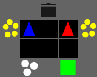
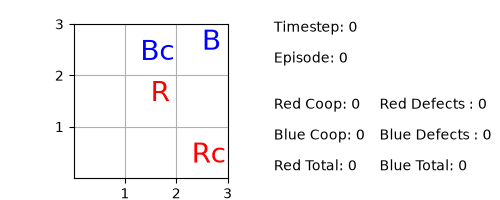

# Policies

`jaxmarl.policies` provides programmed players with known types. Each type is a fixed policy, and the exact probability of every move it makes is recorded. Use them as partners or opponents whose type a learner has to work out, and as ground truth: the exact posterior over a player's type can be computed from any recorded run.

| Family | Env | Types |
| --- | --- | --- |
| `overcooked_v2.soup` | Overcooked-V2, full view, 2 players | runner, plater, flex, lazy |
| `coin_game.reciprocity` | Coin Game | cooperator, defector, tit_for_tat, grim |

{ width=240px }
{ width=420px }

The GIFs come from `python -m jaxmarl.policies.overcooked_v2.demo` and `python -m jaxmarl.policies.coin_game.demo`, which also print the posterior over each player's type.

## Concepts

- **Policy**: code only. `step(params, mem, seen)` returns the new memory and the logits of the next move.
- **Type**: the `params` of a policy. A **Population** is one policy, a stacked set of types with names, and a prior over them.
- **Seat**: an entry of `env.agents`. Each seat played by a population draws a type from the prior at the start of every episode.

Every policy follows four rules, which make replay and the exact posterior possible:

1. No randomness: `step` returns logits, and the runner makes the only random draw.
2. Memory depends only on what the seat saw and did.
3. Hidden choices, such as a goal, are summed over inside `step`, never sampled.
4. A policy reads only its `view`, by default the env's observation for the seat.

## Roll out and infer the type

```python
import jax
from jaxmarl import make
from jaxmarl.policies import rollout, type_posterior
from jaxmarl.policies.coin_game.reciprocity import make_population

env = make("coin_game")
population = make_population(env)
seats = {"0": population.only("defector"), "1": population}  # seat 1 draws a type

traj = jax.jit(lambda key: rollout(env, seats, key, 100))(jax.random.PRNGKey(0))
log_post = type_posterior(population, env, traj, "1")  # [T, K]
print(traj.type_idx[-1, 1], jax.numpy.exp(log_post[-1]))
```

`rollout` returns a `Traj`: states, observations, moves, the exact log-probabilities of every seat's move, rewards, and the type playing each seat. It can be `vmap`-ed over keys.

## Train against a population

`FixedSeats` is a `MultiAgentEnv` in which some seats are played by populations; only the other seats are exposed, so JaxMARL wrappers and training scripts run on it unchanged.

```python
import jax
from jaxmarl import make
from jaxmarl.policies import FixedSeats
from jaxmarl.policies.overcooked_v2.soup import make_population

base = make("overcooked_v2", layout="cramped_room")
env = FixedSeats(base, {"agent_1": make_population(base)})
obs, state = env.reset(jax.random.PRNGKey(0))  # env.agents == ["agent_0"]
truth = env.seat_state(state, "agent_1")  # type_idx and next-move logp, for evaluation
```

## Add a policy family

Subclass `Policy`, write a `make_population(env)` that stacks the types' params, and add a case to `tests/policies/conftest.py`. The conformance tests then check that recorded probabilities are distributions, that `replay` reproduces them (rule 2), and that `FixedSeats` leaves the env unchanged.

## API

::: jaxmarl.policies.base.Policy
    options:
        show_root_heading: true

::: jaxmarl.policies.base.Population
    options:
        show_root_heading: true

::: jaxmarl.policies.play.rollout
    options:
        show_root_heading: true

::: jaxmarl.policies.play.FixedSeats
    options:
        show_root_heading: true

::: jaxmarl.policies.play.Traj
    options:
        show_root_heading: true

::: jaxmarl.policies.posterior.type_posterior
    options:
        show_root_heading: true

::: jaxmarl.policies.posterior.replay
    options:
        show_root_heading: true
